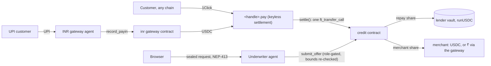

# Runway

Revenue-based credit for merchants paid in stablecoins or UPI, on NEAR.
Each merchant gets a keyless settlement account that splits every incoming payment on-chain between the
loan and the merchant; an attested underwriter agent prices the loan from that routed revenue.

> **Environment: NEAR testnet and a local sandbox only.** Mock USDC, a simulated UPI provider, and agents
> in Shade local mode. Nothing here moves real money (Amendment A1 in [BUILD_PLAN.md](BUILD_PLAN.md)).

## The problem

Freelancers, agencies and small sellers are increasingly paid in USDC or USDT, and in India by UPI. Banks
don't count crypto income, DeFi lending wants more than 100% collateral, and normal underwriting means
handing a lender your accounts and customer list. Card platforms solved this with revenue-based financing
(Stripe Capital, Shopify Capital) because the lender sits in the payment flow. Runway puts a NEAR
settlement contract in that position, and keeps the merchant's off-chain evidence inside an attested agent.

## Try it in 5 minutes

Linux or WSL2 with Rust ≥ 1.95 (plus the 1.86.0 toolchain with the wasm target), `cargo-near` 0.23,
Node 22 and pnpm 10.8 (versions in [BUILD_PLAN.md §Appendix](BUILD_PLAN.md#appendix-verified-versions-and-facts)).

```bash
make setup              # pnpm install
make sandbox-demo-inr   # builds the wasm, then runs the core loop and the INR rail on a private sandbox
```

The sandbox (nearcore 2.14.0) is downloaded once. The run takes about 6 minutes here and prints:

```text
✔ Underwriter agent agent.test.near registered (Shade local mode: whitelisted, mock measurements); session key published on-chain
✔ lender deposited 10000.000000 USDC → 10000.000000 runUSDC
✔ priya.pay.test.near created — access keys: 0, code hash 6Mh5XVhrdn5Nxwd4x2NxgQE8YLsjtjMkKv3PS6DyPfyz (matches factory)
✔ SIMULATED (testnet-style) payment of 3900 USDC via POST /dev/simulate-payment → keeper settled it 100% to Priya
✔ offer #1 via sealed /underwrite (NEP-413 + session key checked on-chain; revenue: sandbox-buckets; anchor: sandbox fixture, not KYC): grade C, limit 500.000000, fee 10%, repay 5.00%; commitment recomputed from the sealed inputs
✔ loan #1 500.000000 disbursed (PendingTerms → PendingTransfer → Active); owed 550.000000
✔ loan #1 repaid automatically from routed payments (4000 / 4100 / 3900 USDC); loans_repaid = 1
✔ offer #2: grade B, limit 2000.000000, fee 7%, repay 17.84%
✔ settle: 1000.000000 in → repay 178.400000 / payout 821.600000
✔ lender withdrew 1000.000000 runUSDC → 1005.549837 USDC (priced at claim, after the cooldown)
✔ invariants I1–I4, I2b, I6, I7 hold
DEMO PASSED
✔ inr-gateway deployed at inr.test.near; credit.inr_gateway set; local InrGateway agent gwagent.test.near; float 1000.000000 USDC
✔ investor2 paid ₹8,500.00 by SIMULATED UPI → 100.000000 USDC deposited → 99.448079 runUSDC at the current share price
✔ customer paid Priya ₹8,500.00 by SIMULATED UPI → 100 USDC to priya.pay.test.near → settle: repay 17.840000 / payout 82.160000 (loan #4)
✔ Priya set payout_mode = Inr and registered pr***@upi; next ₹8,500 sale → 82.160000 USDC → mock payout Paid: ₹6,983.60 (82.16 × 85), UTR hash …
✔ investor2 withdrew all 99.448079 runUSDC in rupees → 100.022956 USDC → mock payout Paid: ₹8,501.95 (USDC × 85)
✔ invariants I1–I8 hold
DEMO (INR) PASSED
```

The underwriter, the INR gateway agent, and the payment API and keeper in this demo are the real packages
running in-process; only the signer differs (sandbox accounts instead of ShadeClient). `make sandbox-demo`
runs the core loop alone. `make test` runs every contract, sandbox and TypeScript test.

## Live demo

Not hosted yet. Deployment waits for the team's go-ahead (Amendment A1, step 3). Once deployed, the
runbook ([BUILD_PLAN §8.2, §8.5](BUILD_PLAN.md#8-deployment-runbooks)) records every account and
transaction in [docs/RUNBOOK.md](docs/RUNBOOK.md), and this section will list the web app, `/verify` and the
exit-app CID. To run the web app against a deployment: `pnpm --filter @runway/web dev` with the
`NEXT_PUBLIC_*` variables from [.env.example](.env.example).

## Do X → see Y

| Do | See |
|---|---|
| `make sandbox-demo-inr` | The output above, ending in `DEMO PASSED` and `DEMO (INR) PASSED` |
| `cargo test -p runway-integration-tests` | Sandbox scenarios pass: failed repay leg retried as repayment, stuck lock recovered once, disbursement state machine, INR gateway G1–G13 and I8, INR payouts through the real gateway (C13, C14, V13, V14) |
| `cargo test --workspace --lib` | Contract unit tests: vault math with dust repayments, late rolls into default, capped recovery, offer bounds, roles, anchors; gateway replay, rate band, caps, payout state machine |
| `pnpm --filter @runway/underwriter test` | Impostor NEP-413 rejected (E3), RPC disagreement aborts (E4), unverifiable payments excluded (E5), commitment reproducible (E6), no secrets in logs (E7), NEAR AI wrong nonce / model mismatch / gateway-only / tampered bytes rejected (E11–E14) |
| `pnpm --filter @runway/inr-gateway test` | Forged or re-serialised webhooks rejected (E16), mismatched payments not recorded (E17), a webhook delivered 3× records once (E18), a crash after `start_payout` pays exactly once (E20), the mainnet bundle contains no mock provider (E22) |
| `pnpm --filter @runway/web test` | The pay page never shows a deposit address for a tampered quote (W1), the 7-status timeline (W2), chain minimums (W3), UPI checkout, ₹ lending and payout settings (W10–W12) |
| `pnpm --filter @runway/underwriter exec tsx scripts/sp8-attestation.ts` | A live NEAR AI Cloud attestation (gateway + model) verified in Node: TDX quote, signer and nonce binding, RTMR3 replay, MRCONFIGID |
| `/pay/<handle>` (after deployment) | The quote checklist goes green before anything can be paid; on testnet the quote is a labelled price preview and the payment is SIMULATED |
| `/audit/offer/<id>` | The offer's hard bounds re-checked in the browser, the agent's role, the commitment recomputed from the merchant's sealed inputs, the settlement account's code hash and zero keys |

## Mainnet proof

None, on purpose: the project runs on testnet only (Amendment A1). NEAR Intents 1Click settles on mainnet
only and refuses testnet recipients (SPIKES SP16), so the testnet pay page requests a real **dry** 1Click
quote (live pricing, signature verified in the browser, no deposit address) and then makes a clearly
labelled SIMULATED payment with mock USDC. The mainnet verification path (signed quote, `/v0/status`
re-read, verified ≤ raw buckets) is implemented and unit-tested, but not deployed.

## Architecture



The full design is [RUNWAY_DESIGN.md](RUNWAY_DESIGN.md); the build plan, interfaces and test catalogue are
[BUILD_PLAN.md](BUILD_PLAN.md); progress is [docs/STATUS.md](docs/STATUS.md).

| Path | What it is |
|---|---|
| `contracts/credit` | Vault and runUSDC shares, agent registry with owner-assigned roles, offers with hard bounds, callback-gated disbursement, periods, provisions, default, recovery, router, withdrawal cooldown priced at claim, INR hooks |
| `contracts/settlement`, `contracts/factory` | Per-merchant account with zero access keys that splits new inflow; the factory creates it with embedded code and publishes the code hash |
| `contracts/inr-gateway` | Converts attested UPI pay-ins to USDC from a float and pays rupee payouts; replay guard, rate band, caps |
| `tee/underwriter` | NEP-413 auth, one-block dual-RPC snapshot, routed revenue, Stripe/Razorpay anchors, NEAR AI statement extraction with end-to-end verification, scoring, commitment, `submit_offer` |
| `tee/inr-gateway` | Collects, webhook verification, `record_payin`, payout worker, encrypted beneficiaries; mock and Razorpay providers |
| `services/api` | Untrusted payment log, SIMULATED payment route (never on mainnet) and the permissionless keeper |
| `apps/web`, `apps/exit` | Next.js app (pay, merchant, capital, settings, lend, audit, verify) and a single-file exit page with no backend |
| `packages/*` | SDK (dual RPC, NEP-413, sealed sessions, 1Click verification), scoring, FX, config, agent kit |

## What's private and what isn't

| Data | Where | Visible to |
|---|---|---|
| Routed payments, buckets, `settled` events | NEAR | Public |
| Offer terms, loans, credit record | NEAR | Public (loan size leaks a coarse revenue signal) |
| Stripe data and account id | Agent memory only; only an HMAC anchor goes on-chain | No one |
| Statements | Agent memory, plus the NEAR AI model TEE | No one |
| Scoring inputs | A commitment on-chain; inputs and salt sealed to the merchant | The merchant, and whoever they show |
| UPI payer IDs | Gateway memory; only an HMAC `payer_ref_hash` on-chain | The payment provider |
| Payout UPI ID or bank account | Gateway contract, as ciphertext only | The gateway (and the provider, to pay out) |
| INR receipts (paise, rate, USDC, time) | Gateway contract | Public, like crypto payments |

On testnet the agents run in **local mode**: whitelisted accounts with mock measurements, so the
"memory only" rows describe the protocol, not hardware isolation, until a TEE deployment.

## Security model and known limits

- **Hard bounds on-chain.** The credit contract re-checks every offer against the policy caps, the
  agent's approved role, the anchor uniqueness and the policy version. A compromised agent is bounded by
  the caps until its measurement is revoked.
- **The API is not trusted.** It isn't in the payment path; its payment list can only omit payments, and
  the agent re-verifies everything. The keeper only calls permissionless methods.
- **Agents read fixed sources.** RPCs, data-source URLs and contract ids are hardcoded per network in each
  image; every chain read goes to two RPCs at the same block and aborts on disagreement.
- **Settlement accounts have no keys** and use immutable code whose hash the factory publishes; failed or
  unknown operations are retried or reconciled exactly.
- **Wash trading is bounded, not prevented** (design §10.6): unanchored caps, one anchor per merchant, a
  daily new-merchant cap. Payer diversity can be faked within those caps. Payment diversion is possible;
  there is no legal recourse, and limits are sized for that.
- **Not audited.** Neither these contracts nor the Shade agent framework they build on have been audited.
  TEE side channels are a research risk. Testnet uses local mode (no hardware isolation) and test-mode
  Stripe keys (not real KYC). USDC can be frozen by its issuer.
- Full threat model: [RUNWAY_DESIGN.md §12](RUNWAY_DESIGN.md#12-threat-model).

## INR rail

USDC stays the base unit: one vault, one share token, loans in USDC. Rupees are converted only at the edges
by the INR gateway agent and contract. UPI sales are routed revenue (they raise the limit); merchants can
take payouts in rupees; investors can deposit and withdraw in rupees. Rates come from a multi-source oracle
over Indian exchanges (CoinDCX, WazirX, Giottus; SPIKES SP13), bounded by a band in the contract.
**On testnet every rupee flow is SIMULATED** with a mock provider whose webhooks go through the same
signature path as a real provider's; the Razorpay adapter is implemented and fixture-tested, but no live
Razorpay account is used.

## Tech and NEAR features used

- NEAR smart contracts in Rust (`near-sdk` 5.26.1): keyless sub-accounts created by a factory, NEP-141
  `ft_transfer_call` routing with exact receipts, callback-gated state machines, NEP-145 storage.
- Shade agent pattern (`shade-attestation`): on-chain agent registration, owner-approved measurements and
  roles, session keys published on-chain; local mode on testnet.
- NEAR Intents 1Click: quotes requested and signature-verified in the browser (dry quotes on testnet).
- NEP-413 signed messages with a FullAccess-key check on two RPCs.
- NEAR AI Cloud private inference with model-level attestation and signed responses (verified end to end).
- TypeScript: Hono, Next.js 16, wallet-selector 10, noble crypto, zod, Vitest; `near-workspaces` sandboxes.

## Tracks

`defi`, `realworld`, `privacy`, `security` (design §18).

## Code hashes

Base58 sha256 of the wasm, the format NEAR reports as `code_hash`. These come from a local
non-reproducible build (`res/CODE_HASHES.txt`); the CI artifact is the reference until reproducible builds
are set up (SPIKES SP10).

```text
7ZzY9xYc92dbwqki4hMHADw7uSXUKJk2FRRoGZXHdeiX  runway_credit.wasm
HcBpma1QhqXm9i1t5fL9hA8k4osWApJPS28A6EUBw1RJ  runway_factory.wasm
2bLtpuJuVh1drEkKJBGfvAJka7f5WBzXvyDddy4qnUhV  runway_inr_gateway.wasm
DQ4Sox5vMiwLfL8G7AZun7gkVTjjzims62tSSh2ugwCy  runway_mock_usdc.wasm
6Mh5XVhrdn5Nxwd4x2NxgQE8YLsjtjMkKv3PS6DyPfyz  runway_settlement.wasm
Avfwu43HhUc2yBd75jHNAFUcSZjSAEtauk2KyruzFPXc  runway_stub_gateway.wasm
```

## Hackathon window

All code in this repository was written during NEAR HACKATHON, starting 2026-11-10 (design) and
2026-11-11 (first commit); there is no pre-hackathon baseline (Q-001 to Q-004). Disclosures (Q-005):

- **AI-written code.** Most of the code and documents were written with an AI coding agent (Claude Code)
  under the team's direction and review.
- **Templates.** The contracts keep the Shade agent contract template's method names so the Shade CLI
  works; the agent-registry logic follows `shade-attestation`. No other template was used.
- **Libraries.** `near-sdk`, `near-contract-standards`, `shade-attestation`, `near-workspaces`;
  `@defuse-protocol/one-click-sdk-typescript`, `@neardefi/shade-agent-js`, `@phala/dcap-qvl`,
  `@phala/dstack-sdk`, `@noble/*`, `hono`, `zod`, `papaparse`, `pdfjs-dist`, `next`, `react`,
  `@near-wallet-selector/*`, `recharts`, `qrcode.react`, `tailwindcss`, `vite`, `vitest`. Versions are
  pinned in `Cargo.toml` and the `package.json` files.

## License

MIT, see [LICENSE](LICENSE).
